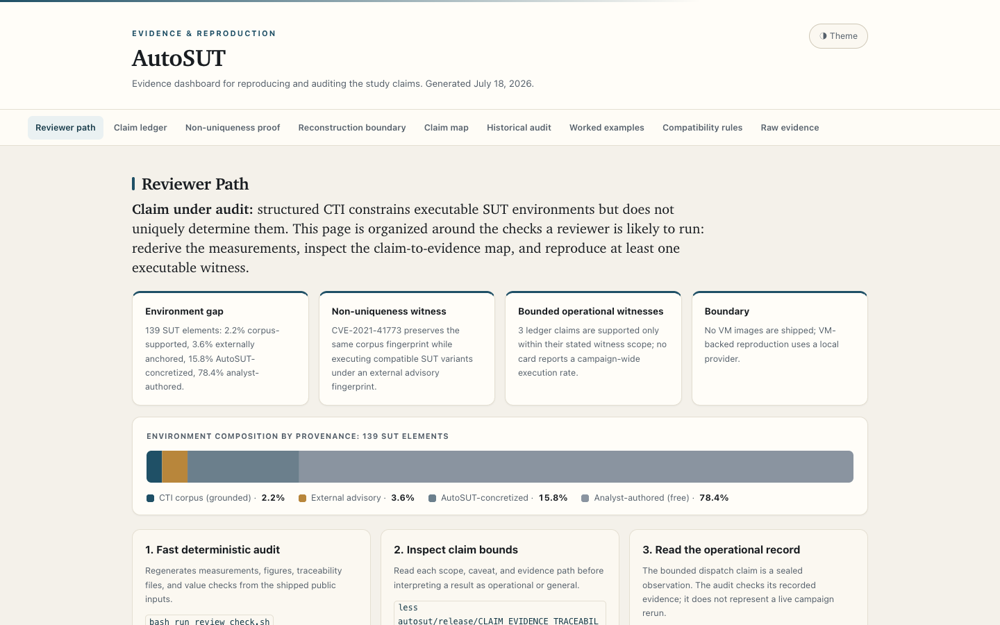

# AutoSUT Reproducibility Artifact

This repository contains the reviewer-facing artifact for the
environment-semantics measurement study. It is intentionally
venue-neutral: the repository name, files, and commands do not depend
on a specific conference track.

## Repository Structure

- `autosut/src/`: typed environment, lifecycle, execution, and evidence modules.
- `autosut/measurement/`: pinned inputs and the measurement pipeline.
- `autosut/release/`: claim traceability, ledger-linked evidence, and dashboard.
- `autosut/tests/`: unit, contract, and reproducibility checks.
- `ARTIFACT_BOUNDARY.md`: included and excluded release surfaces.

## Evaluation Qualities

This release is prepared for availability, functionality, sustainability,
and experiment-reproducibility review. Availability also depends on the
distribution channel providing this package through a stable public URL.

## Basic Information

The primary path requires a POSIX-like shell, Python 3.10 or later,
`venv`, `pip`, two CPU cores, 4 GiB of RAM, and 2 GiB of free disk.
No GPU is needed. Allow ten minutes for first-run dependency installation
and validation; runtime varies by host. Docker is required only for the
separately identified optional operational witnesses.

## Dependencies

`autosut/requirements-reviewer.txt` pins every Python dependency exactly.
The reviewer wrapper creates `autosut/.venv` and enforces those versions.
Pinned ATT&CK, CAPEC, and FiGHT snapshots ship inside the package; the
measurement path does not download research inputs at runtime.

The primary gate explicitly deselects two native Windows media checks.
They remain available through the separate qualification command below;
a passing primary gate does not qualify FAT/ISO files or a Windows VM.

### Native Windows Media Qualification

After the primary wrapper installs the reviewer environment, run:

```bash
autosut/.venv/bin/python autosut/scripts/qualify_windows_media.py --preflight-only
autosut/.venv/bin/python autosut/scripts/qualify_windows_media.py
```

This separate path requires `qemu-img`, `mformat`, `mcopy`, `mtype`,
and `xorriso` on PATH. Preflight only reports readiness. The full command
creates real temporary FAT/ISO files, checks their contents, and fails
if tools or media checks fail. It does not boot or qualify Windows.
No utilities are installed automatically or with elevated privileges.

## Security Considerations

The primary gate performs local measurement and validation only. It needs
no API key, cloud credential, privileged service, Docker daemon, Caldera,
or VM. Optional Docker-backed witnesses instantiate deliberately susceptible
laboratory services and replay adapted actions. Run those paths only on an
isolated disposable host; never expose their networks or services publicly.

## Installation

Extract or clone the repository, enter its root, and run the reviewer wrapper.
On first use it creates the pinned local environment automatically:

```bash
bash run_review_check.sh
```

## Minimal Test

```bash
python3 autosut/scripts/verify_artifact_manifest.py --root .
bash run_review_check.sh
```

Expected result: manifest verification succeeds, all measurement and claim
gates pass, and the command exits with status zero.

## Fast Reviewer Path

```bash
bash run_review_check.sh
```

The wrapper first verifies every packaged file against
`ARTIFACT_MANIFEST.md`, then reruns the measurement pipeline from frozen
public input snapshots, regenerates figures and traceability outputs, and
validates numeric invariants. This ZIP is the evidence and reproduction package.

The pinned reviewer environment is created automatically. The command does not
require API keys, private data, paid services, Caldera, Docker, or VM
startup.

To verify package integrity without running the study pipeline:

```bash
python3 autosut/scripts/verify_artifact_manifest.py --root .
```

The public-surface audit writes two reviewer-local reports only under
`autosut/results/reviewer_runtime/`. They are not claim evidence or
manifest entries. After running that audit, add `--allow-runtime-state`
to permit exactly those reports and ordinary local tool state; every
manifest-listed file remains checked byte-for-byte.

## Evidence Dashboard

The reviewer-facing static dashboard is
`autosut/release/dashboard/index.html`. After downloading and
extracting the ZIP, the lowest-friction local view is:

```bash
python3 -m http.server 8765 --bind 127.0.0.1
```

Run the command from the extracted repository root, not the dashboard directory.
Then open `http://127.0.0.1:8765/autosut/release/dashboard/` in a browser. Opening
`index.html` directly also works after ZIP extraction.
The dashboard summarizes the canonical claim ledger, historical replay audit,
bounded witness records, and raw CSV/JSON anchors without requiring a
server beyond the optional local static-file command above.

Dashboard preview:



## Full Docker Replay

```bash
cd autosut
python3 scripts/run_all_orchestrated_campaigns.py --preflight-only
python3 scripts/run_all_orchestrated_campaigns.py --isolate-campaigns --campaign-timeout-seconds 1200
```

This path replays the implemented Docker-backed campaign/SUT pairs
and writes TSV/JSON reports under `release/`. It is slower than the
fast validation path and requires Docker; the preflight separates
infrastructure readiness from campaign failures before the long run.
`--isolate-campaigns` is the recommended reviewer mode: it cleans
AutoSUT containers, networks, and volumes around each campaign.
This includes the AutoSUT Caldera container. No unrelated resource
may use the reserved autosut- prefix during the run.
The retrospective replay audit checks recorded counts and source-file
hashes. It does not qualify the current implementation or establish
technique fidelity. Its local source traces are not bundled.
Fresh replay evidence is kept under
`autosut/release/evidence/_reviewer_runs/`, preserving the
released claim ledger and its ledger-linked evidence while allowing
`bash run_review_check.sh` to pass after a full replay.
This optional path is not evidence that every public campaign has a qualified
campaign/SUT pair, and it must not be used to broaden the bounded claim ledger.

## Executable Non-Uniqueness Witness

```bash
cd autosut
bash artifact/setup.sh
.venv/bin/python3 scripts/prove_subdetermination.py 0.cve_2021_41773 --variants 2 --execute
```

This Docker-backed witness varies only analyst-authored SUT elements
while preserving the declared fixed-evidence fingerprint and executing the
CVE-2021-41773 mechanism in each compatible variant.
The canonical RQ1--RQ4, bounded dispatch, and C0045 status is in
`autosut/release/CLAIM_EVIDENCE_TRACEABILITY.md`; unsupported
interpretations are listed there explicitly.

## Experiments and Claims

Run `bash run_review_check.sh` from the package root for every claim below.
No configuration edit or credential is required for the primary path.

Ledger claim identifiers are stable and predate the manuscript's grouping
into three questions: ledger RQ1 and RQ3 support manuscript RQ1, ledger RQ2
supports RQ2, and ledger RQ4 with the C0045 study supports RQ3.

### RQ1: Structured Environment Evidence

The gate regenerates corpus platform, software, version, CPE, and CVE tables
from the pinned snapshots. Inspect
`autosut/measurement/sut/scripts/results/` and the RQ1 row in
`autosut/release/CLAIM_EVIDENCE_TRACEABILITY.md`.

### RQ2: Declared Compatibility Policy

The same gate regenerates routing labels, rule-surface records, and sensitivity
outputs. Expected status is `supported`; the configuration baseline remains
separately labeled `supported_baseline`.

### Bounded Caldera Dispatch Witness

The claim ledger statically validates the sealed serial collection under
`autosut/release/experiments/operational_qualification/2026-09-05-r6/`.
Expected status is `supported_bounded`: one surrogate cell, one seed, and one
independently verified effect. This package check does not launch Docker or
Caldera, and the result is not campaign-wide execution evidence.

### RQ3: Profile Distinctiveness

The gate recomputes profile-distance and sparse-profile null-model outputs.
Expected status is `supported` without interpreting the observed decline as
evidence beyond the registered null-model result.

### RQ4: Environment Non-Uniqueness

The gate verifies the constructive argument and frozen bounded witnesses.
Expected status is `supported_bounded`. It does not establish automatic range
generation or corpus-wide operational replay.

## Layout

- `autosut/`: artifact code, version-pinned bundles, release outputs, and reviewer scripts.
- `ARTIFACT_BOUNDARY.md`: what is included and intentionally excluded.
- `ARTIFACT_MANIFEST.md`: SHA-256 manifest for the staged repository.

## License

The AutoSUT artifact is released under the MIT License; see `autosut/LICENSE`.
